# Mangos on phones and tablets

## Short version

- **Mobile access URL:** https://mangoslearningenglish.vercel.app/
- **Repository:** https://github.com/Mangos-Term-Project/mangos_web (the same repository as the web app)
- **What it is:** an installable web app (a Progressive Web App, or PWA). It is not a separate Kotlin, Swift or React Native app, and it is not in the Google Play Store or Apple App Store.

## How the mobile app is built

Mangos is one React app that adapts to the screen it runs on. The mobile
version is the same code, made installable with
[vite-plugin-pwa](https://vite-pwa-org.netlify.app/):

- `vite.config.js` defines the app manifest: the name "Mangos Learning English", the mango icon, colors, and `display: standalone`, so the installed app opens full screen without browser bars.
- A service worker (generated at build time and registered in `src/main.jsx`) saves the app's files on the device so it opens quickly. It updates itself automatically when a new version is deployed.
- The page layouts use CSS breakpoints between 360px and 820px wide, so phones get single-column layouts, larger touch targets and a one-row top bar.
- Drawing uses pointer events, so it works the same with a finger, a stylus or a mouse.

Because web and mobile share one codebase and one server, every feature,
account, card, coin and pet is the same on both, and a learner can switch
between a computer and a phone at any time.

## Installing it

### Android (Chrome)

1. Open **https://mangoslearningenglish.vercel.app/** in Chrome.
2. Tap the **⋮** menu in the top-right corner.
3. Tap **Install app** (on some phones it says **Add to Home screen**).
4. Tap **Install**. The Mangos icon appears on your home screen.

### iPhone and iPad (Safari)

1. Open **https://mangoslearningenglish.vercel.app/** in Safari.
2. Tap the **Share** button (a square with an arrow pointing up). On iPhone it is at the bottom; on iPad it is at the top.
3. Scroll down and tap **Add to Home Screen**.
4. Tap **Add**. The Mangos icon appears on your home screen.

Screen readers: on iPhone, VoiceOver reads the button as "Share"; on
Android, TalkBack reads the menu as "More options".

## Online requirement

Mangos needs an internet connection. Sign-in, saving cards, reviews,
the quiz, coins, pets and picture search all use the server. The installed
app opens without a connection, but it then shows a "Could not reach the
server" message instead of your cards. Login sessions last one hour, so
learners sign in again after that.

## How the mobile version differs from the web version

| | Computer (web) | Phone (installed or in the browser) |
|---|---|---|
| Features | All features | All features (same accounts and data) |
| How it opens | Browser tab | Home-screen icon, full screen, no browser bars |
| Drawing | Mouse or trackpad | Finger or stylus |
| Top bar | Icons with labels, coin balance, "Español"/"English", Sign out | Same icons and coins; language button shortened to "ES"/"EN"; Sign out moves to the Account page |
| Review cards | One large card (about 760×440 px) | One card filling the screen width |
| Draw page | Canvas and picture search side by side | Canvas first, picture search below |
| Store and House | 3 items per row | 2 items per row |
| Updates | On the next page load | Automatically in the background |
| App stores | Not applicable | Not in Google Play or the App Store; installed from the website |

## Screens (phone, 390×844)

Captured from the current version of the app running on a local test server.

| | | |
|---|---|---|
| 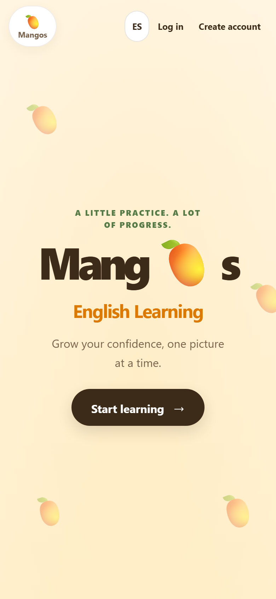 | 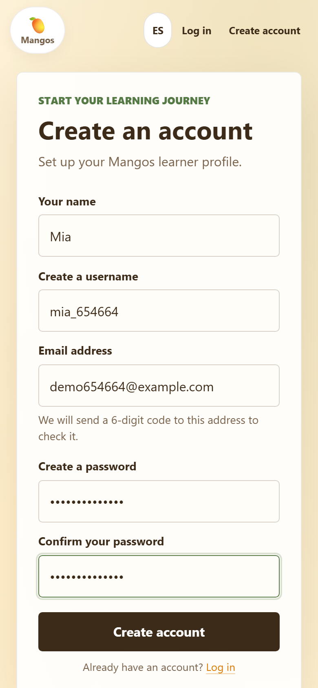 | 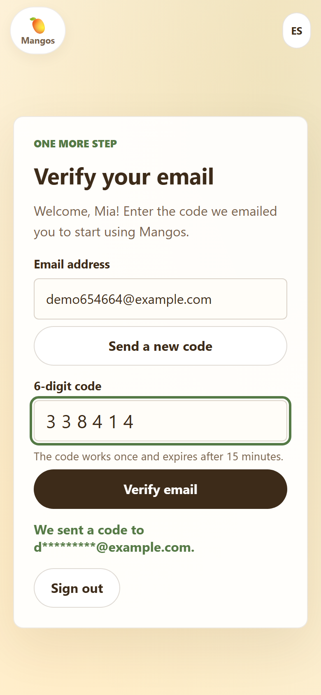 |
| Start | Sign-up asks for an email | Enter the emailed code |
| 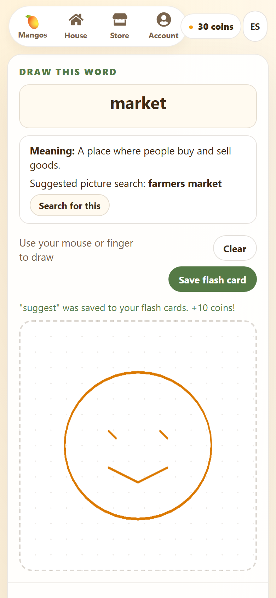 | 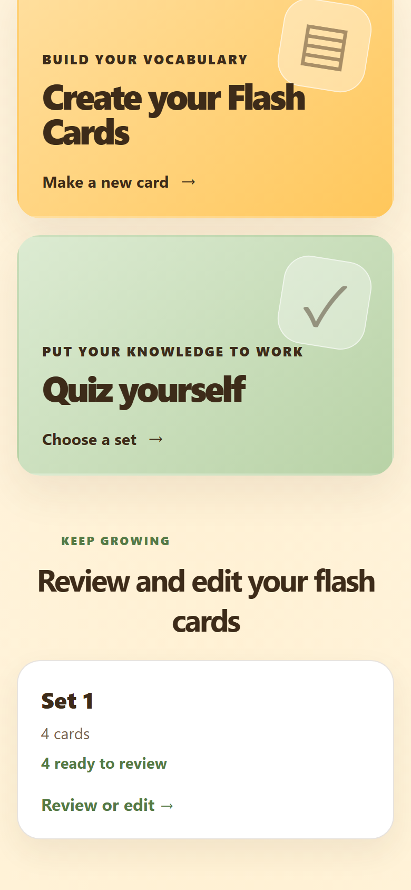 | 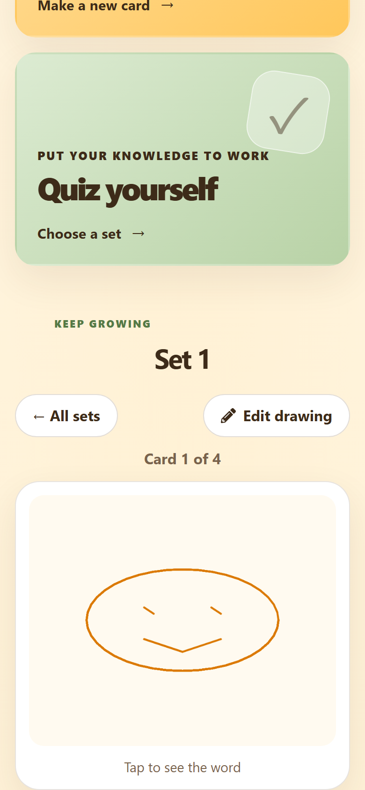 |
| Draw a word, with hint and coins | Clickable card sets | One large review card |
| 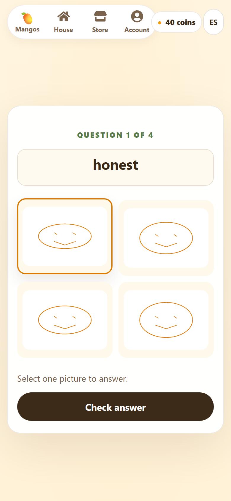 | 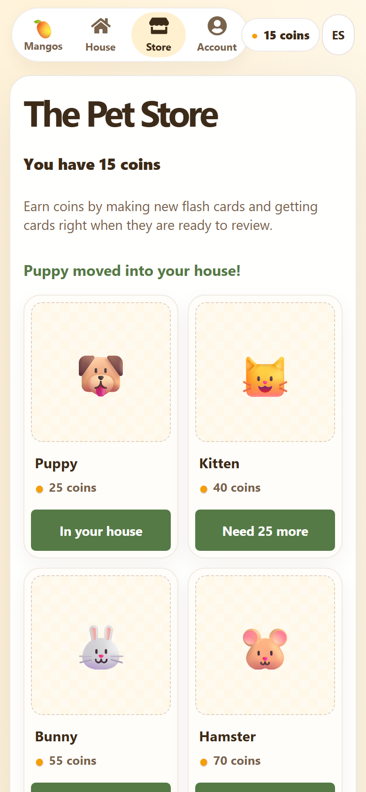 | 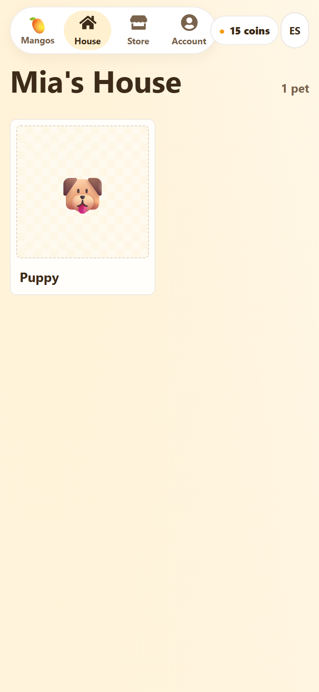 |
| Quiz with your own drawings | Pet store with coin checks | Pets in your house |
| 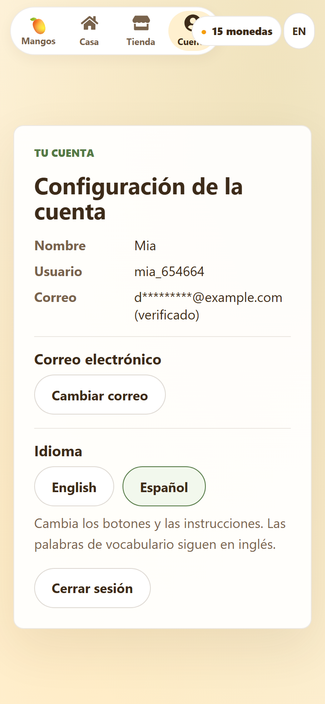 | 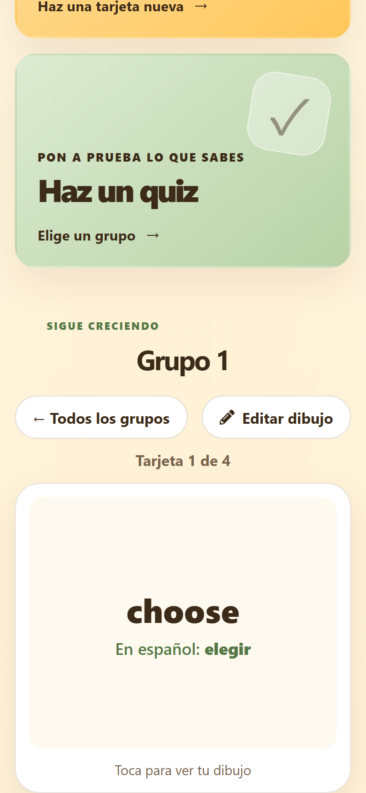 | |
| Account page, Spanish mode | Review card with the Spanish translation | |

## Text for the report (Technical Background)

> **Mobile application.** The Mangos mobile app is a Progressive Web App
> built from the same React and Vite codebase as the web app, in the same
> GitHub repository (https://github.com/Mangos-Term-Project/mangos_web).
> vite-plugin-pwa generates a web app manifest and a service worker, so
> learners can install Mangos from https://mangoslearningenglish.vercel.app/
> to an Android or iPhone home screen, where it opens full screen like a
> native app. Responsive CSS layouts adapt every page to phone screens, and
> pointer events let learners draw with a finger. Both versions use the
> same FastAPI server, PostgreSQL database and Redis sessions, so accounts,
> cards, coins and pets are shared. The mobile version differs only in
> layout (single column, a compact top bar, Sign out on the Account page)
> and installation (from the website rather than an app store). It needs
> an internet connection. We chose a PWA over a separate native app so the
> team maintains one codebase and every feature ships to both platforms at
> the same time.
